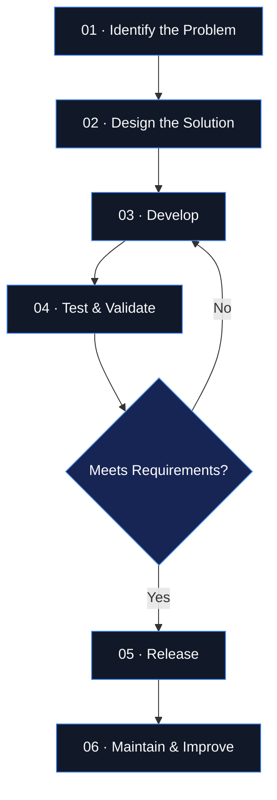

 

# DigiX

### Building tools that make a difference.

**Software Engineering · Bots · Developer Tools**

---

## `01` — Who We Are

DigiX is a software engineering organization focused on building practical software, automation bots, and developer tools.

We turn ideas into working solutions, prioritizing maintainability, reliability, and thoughtful engineering over unnecessary complexity.

Our work revolves around three core areas:

| Area | Focus |
|---|---|
| **Software Engineering** | Practical applications and maintainable systems |
| **Bots & Automation** | Automated workflows and useful integrations |
| **Developer Tools** | Utilities that improve development workflows |

## `02` — Engineering Workflow

Our preferred engineering process follows a simple principle: understand the problem, design the solution, validate the implementation, and improve it continuously.

## `03` — Our Engineering Principles

- **Reliability:** Build software that behaves predictably.
- **Maintainability:** Keep code readable, modular, and manageable.
- **Simplicity:** Choose the simplest solution that meets the requirements.
- **Automation:** Reduce repetitive work wherever practical.
- **Continuous Improvement:** Test, review, learn, and iterate.

## `04` — Explore Our Projects

The best way to discover DigiX is to explore our repositories.

We encourage you to review each project's documentation, installation instructions, license, and contribution guidelines before using or modifying its code.

## `05` — Collaboration

Interested in working with us?

1. Explore our public repositories.
2. Open an issue to report a bug or propose an improvement when the project supports it.
3. Follow the contribution guidelines of the repository.
4. Submit focused, well-documented changes.

Contributions are subject to each project's license and maintainer guidelines.

## `06` — Connect

- **Organization:** [github.com/Digix-Team](https://github.com/Digix-Team)
- **Projects:** [Browse repositories](https://github.com/orgs/Digix-Team/repositories)

---

**DigiX**  
*Building tools that make a difference.*

Engineered with purpose. Improved through iteration.

